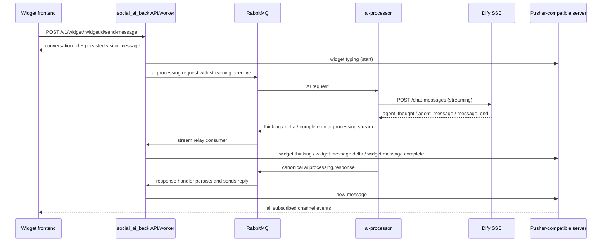

# Website widget AI streaming: frontend integration guide

This document describes the current live-message contract for website-widget AI
replies when inference runs in the `ai-processor` service. It is based on the
implementation in this repository and the sibling `ai-processor` service, not
on the provider's raw SSE format.

The frontend does **not** connect to RabbitMQ or Dify. It subscribes to a private
Pusher-compatible channel exposed by `social_ai_back`.

## Contract summary

| Item               | Contract                                                                         |
| ------------------ | -------------------------------------------------------------------------------- |
| Transport          | Pusher Channels protocol (`pusher-js` in the browser)                            |
| Channel            | `private-conversation-<conversationUlid>`                                        |
| Channel auth       | `POST /v1/widget/:widgetId/auth/pusher`                                          |
| Auth header        | `Authorization: Bearer <widget-session-token>`                                   |
| Progressive events | `widget.thinking`, `widget.message.delta`, `widget.message.complete`             |
| Canonical event    | `new-message`                                                                    |
| Fallback event     | `widget.typing`                                                                  |
| Delivery guarantee | Progressive events are best-effort and have no replay                            |
| Source of truth    | The persisted message delivered by `new-message` or returned by the messages API |

Every Pusher event is sent through the notification driver and therefore has a
wrapper. The event-specific payload is under **`envelope.data`**:

```ts
interface PusherEnvelope<T> {
  title: string
  body: string
  data: T
  priority?: string
  eventName: string
  // Other notification fields can be absent.
}
```

Do not read `stream_id`, `delta`, or `status` from the top level.

## End-to-end event flow



The stream queue and the canonical response queue are separate. Consequently,
the relative arrival order of `widget.message.complete` and `new-message` is
not a frontend contract.

## When streaming is available

All of the following must be true:

- The conversation platform is `website_widget`.
- The selected AI provider is Dify and its mode is `agent`.
- `WIDGET_STREAMING_ENABLED` is not set to `false`. It defaults to enabled.
- The request is actually routed through a path that adds the `streaming`
  directive. Normal single-agent processor requests and processor-backed
  regeneration do this. The multi-agent orchestrator-step publisher currently
  does not.
- An application worker is running with `RUN_WORKERS=true`.
- The monolith stream relay is running. In the current implementation it starts
  only when the global `AI_PROCESSOR_ENABLED=true`.
- The processor and monolith use the same stream queue:
  `RABBITMQ_STREAM_QUEUE` in `ai-processor` must equal
  `AI_PROCESSOR_STREAM_QUEUE` in the monolith. The default on both sides is
  `ai.processing.stream`.
- Pusher credentials are configured on the backend.

The frontend must still work when any of these conditions is false. In that
case it receives the existing typing and final-message events without deltas.

## Install and configure `pusher-js`

```bash
pnpm add pusher-js
```

The Pusher key and cluster are public frontend configuration, but the current
widget `GET /config` response does not supply them. Inject them through the
frontend's environment/runtime configuration. Never expose the Pusher secret.

The example below uses the current `pusher-js` channel authorization API:

```ts
import Pusher, { type Channel } from 'pusher-js'

interface SubscribeOptions {
  apiBaseUrl: string // Example: https://api.example.com
  widgetId: string
  conversationUlid: string
  sessionToken: string // Returned by POST /v1/widget/:widgetId/register
  pusherKey: string
  pusherCluster: string
}

export function subscribeToWidgetConversation(options: SubscribeOptions): {
  pusher: Pusher
  channel: Channel
  dispose: () => void
} {
  const apiBaseUrl = options.apiBaseUrl.replace(/\/$/, '')
  const channelName = `private-conversation-${options.conversationUlid}`

  const pusher = new Pusher(options.pusherKey, {
    cluster: options.pusherCluster,
    forceTLS: true,
    channelAuthorization: {
      transport: 'ajax',
      endpoint: `${apiBaseUrl}/v1/widget/${options.widgetId}/auth/pusher`,
      headers: {
        Authorization: `Bearer ${options.sessionToken}`,
      },
    },
  })

  const channel = pusher.subscribe(channelName)

  channel.bind('pusher:subscription_error', (error: unknown) => {
    console.error('Widget realtime subscription failed', error)
  })

  return {
    pusher,
    channel,
    dispose: () => {
      channel.unbind_all()
      pusher.unsubscribe(channelName)
      pusher.disconnect()
    },
  }
}
```

For a new visitor, `conversationUlid` may not exist until the first
`POST /v1/widget/:widgetId/send-message` succeeds. Use the returned
`conversation_id`, then subscribe. For an existing conversation, subscribe
before sending the next message to avoid missing its early events. Wait for
`pusher:subscription_succeeded` before sending when the stream must be observed:

```ts
await new Promise<void>((resolve, reject) => {
  channel.bind('pusher:subscription_succeeded', () => resolve())
  channel.bind('pusher:subscription_error', (error: unknown) => reject(error))
})
```

The auth endpoint accepts the `socket_id` and `channel_name` automatically sent
by `pusher-js`. It verifies that the widget session owns the conversation:

- `400`: malformed body or invalid channel name.
- `401`: missing, invalid, or expired widget session token.
- `403`: the conversation does not belong to this widget visitor.

## Event reference

### `widget.typing`

Typing is a coarse fallback and lifecycle hint.

```ts
interface WidgetTypingData {
  sender_type: 'ai' | 'agent' | 'system'
  sender_id: string | null
  sender_name: string | null
  status: 'start' | 'stop'
  conversation_id: string
  timestamp: string
}
```

Example:

```json
{
  "title": "Typing indicator",
  "body": "Typing start",
  "eventName": "widget.typing",
  "data": {
    "sender_type": "ai",
    "sender_id": null,
    "sender_name": "AI Assistant",
    "status": "start",
    "conversation_id": "01J...",
    "timestamp": "2026-07-30T10:00:00.000Z"
  }
}
```

Treat `stop` as advisory. In the processor path it can be emitted before the
first delta, and it must not cause the UI to discard an active streamed bubble.

### `widget.thinking`

Emitted from a non-empty Dify `agent_thought`.

```ts
interface WidgetThinkingData {
  conversation_id: string
  stream_id: string
  text: string
}
```

Render this as transient status text, not as part of the answer. Treat it as
untrusted plain text; do not insert it as HTML. There can be zero, one, or many
thinking events.

### `widget.message.delta`

Contains one answer fragment.

```ts
interface WidgetDeltaData {
  conversation_id: string
  stream_id: string
  delta: string
  seq: number // Starts at 0 for this processor request.
}
```

`stream_id` groups one generated reply. `seq` is the ordering and deduplication
key within that stream. Do not assume callback arrival order is the same as
`seq` order.

### `widget.message.complete`

```ts
interface WidgetCompleteData {
  conversation_id: string
  stream_id: string
}
```

This means the processor observed Dify's end-of-message SSE event. It does not
mean the reply has been persisted, and it has no message ULID. Keep the
provisional bubble until `new-message` arrives.

This event can be missing on interruption, provider failure, a dropped
best-effort event, or an unexpected provider stream ending without the expected
end event.

### `new-message`

This is the authoritative persisted message event:

```ts
interface WidgetMessage {
  ulid: string
  type: 'message'
  content?: string
  message_type: string
  sender_type: 'contact' | 'human_agent' | 'ai_agent' | 'system'
  media_url?: string
  sent_at: string
  status: 'sent' | 'delivered' | 'read' | 'failed'
  sender_name?: string
  sender_avatar?: string
  components?: unknown[]
  template_ulid?: string
  interactive_metadata?: Record<string, unknown>
  is_csat_survey?: boolean
  next_messages?: unknown[]
  widget_template?: Record<string, unknown>
}

interface NewMessageData {
  message: WidgetMessage
  conversationUlid: string
  timestamp: string
}
```

Example envelope:

```json
{
  "title": "New Message",
  "body": "Here are the matching products.",
  "eventName": "new-message",
  "data": {
    "message": {
      "ulid": "01J...",
      "type": "message",
      "content": "Here are the matching products.",
      "message_type": "widget_message",
      "sender_type": "ai_agent",
      "sent_at": "2026-07-30T10:00:04.000Z",
      "status": "sent",
      "next_messages": []
    },
    "conversationUlid": "01J...",
    "timestamp": "2026-07-30T10:00:04.100Z"
  }
}
```

The canonical event currently does not contain `stream_id`. Under the normal
one-reply-at-a-time conversation flow, reconcile an AI `new-message` with the
conversation's active provisional stream. If the UI permits overlapping
regenerations, there is no deterministic final-message-to-stream mapping in
the current contract; prefer the persisted message and clear stale
provisionals.

## Recommended frontend state handling

Use a per-stream buffer keyed by `stream_id`, and only append contiguous
sequence numbers. This handles duplicates and out-of-order delivery without
rendering scrambled text.

```ts
interface StreamState {
  conversationId: string
  text: string
  thinking: string
  nextSeq: number
  pending: Map<number, string>
  completeSeen: boolean
  updatedAt: number
}

const streams = new Map<string, StreamState>()

function getStream(streamId: string, conversationId: string): StreamState {
  let state = streams.get(streamId)
  if (!state) {
    state = {
      conversationId,
      text: '',
      thinking: '',
      nextSeq: 0,
      pending: new Map(),
      completeSeen: false,
      updatedAt: Date.now(),
    }
    streams.set(streamId, state)
  }
  return state
}

function unwrap<T>(envelope: PusherEnvelope<T>): T {
  return envelope.data
}

channel.bind('widget.thinking', (envelope: PusherEnvelope<WidgetThinkingData>) => {
  const event = unwrap(envelope)
  const state = getStream(event.stream_id, event.conversation_id)
  state.thinking = event.text
  state.updatedAt = Date.now()
  renderThinking(state.conversationId, event.stream_id, state.thinking)
})

channel.bind('widget.message.delta', (envelope: PusherEnvelope<WidgetDeltaData>) => {
  const event = unwrap(envelope)
  const state = getStream(event.stream_id, event.conversation_id)

  // Already rendered or already buffered: duplicate delivery.
  if (event.seq < state.nextSeq || state.pending.has(event.seq)) return

  state.pending.set(event.seq, event.delta)
  while (state.pending.has(state.nextSeq)) {
    state.text += state.pending.get(state.nextSeq)
    state.pending.delete(state.nextSeq)
    state.nextSeq += 1
  }

  state.thinking = ''
  state.updatedAt = Date.now()
  renderProvisionalAiMessage(state.conversationId, event.stream_id, state.text)
})

channel.bind('widget.message.complete', (envelope: PusherEnvelope<WidgetCompleteData>) => {
  const event = unwrap(envelope)
  const state = getStream(event.stream_id, event.conversation_id)
  state.completeSeen = true
  state.updatedAt = Date.now()
  // Do not convert the provisional bubble into a final message here.
})

channel.bind('widget.typing', (envelope: PusherEnvelope<WidgetTypingData>) => {
  const event = unwrap(envelope)
  if (event.status === 'start') {
    showTypingFallback(event.conversation_id)
  } else {
    hideTypingFallback(event.conversation_id)
  }
})

channel.bind('new-message', (envelope: PusherEnvelope<NewMessageData>) => {
  const event = unwrap(envelope)
  upsertCanonicalMessage(event.message) // Dedupe by message.ulid.

  if (event.message.sender_type === 'ai_agent') {
    hideTypingFallback(event.conversationUlid)
    removeProvisionalStreamsForConversation(event.conversationUlid)
  }
})
```

The example deliberately leaves rendering functions application-specific.
`upsertCanonicalMessage` should replace or remove the provisional UI and render
the complete persisted object, including `next_messages`, components, media,
and widget templates.

## Reconnect and recovery

Pusher subscriptions do not replay missed events. On initial subscription and
after a connection transition back to `connected`:

1. Fetch `GET /v1/widget/:widgetId/conversations/:conversationId/messages`.
2. Upsert returned messages by `message.ulid`.
3. Remove provisional streams older than a short UI timeout.
4. Keep any newer provisional stream only until its canonical message arrives
   or the timeout expires.

Suggested connection hook:

```ts
pusher.connection.bind('state_change', async ({ current }: { current: string }) => {
  if (current === 'connected') {
    await hydrateConversationMessages()
  }
})
```

Also hydrate on page load. The REST result and `new-message` are authoritative;
never persist reconstructed delta text as if it were a server message.

## Event ordering and failure rules

Frontend code must allow all of these:

- No streaming events at all, followed by `new-message`.
- Thinking events followed by deltas, with or without `complete`.
- Deltas with duplicate or out-of-order `seq` values.
- `complete` arriving before a delayed lower-sequence delta.
- `new-message` arriving before or after `complete`.
- A partial stream that never gets a canonical message because generation
  failed or was stopped.
- Disconnect/reconnect after some deltas; missed deltas are not replayed.

Progressive stream events are intentionally non-persistent, expire from the
RabbitMQ relay queue after 60 seconds, and failures are swallowed so they cannot
break AI reply delivery. This makes streaming a UI enhancement, not a data
source.

## Cleanup

Unbind and unsubscribe when switching conversations or unmounting the widget.
If one Pusher connection is shared across the widget, unsubscribe only the old
conversation channel and disconnect the client only when the whole widget is
destroyed.

Clear stale `StreamState` entries after a bounded timeout even when
`complete` was seen. This prevents an interrupted reply from leaving a
permanent provisional bubble or memory leak.

## Backend implementation notes for troubleshooting

The processor translates Dify SSE events as follows:

| Dify SSE event                           | Relay event | Browser event             |
| ---------------------------------------- | ----------- | ------------------------- |
| `agent_thought` with non-empty `thought` | `thinking`  | `widget.thinking`         |
| `agent_message` or `message`             | `delta`     | `widget.message.delta`    |
| `message_end` or `agent_message_end`     | `complete`  | `widget.message.complete` |

Useful backend checks:

- The AI request contains
  `streaming: { enabled: true, conversationUlid, streamId }`.
- `ai-processor` logs the Dify streaming response and publishes to
  `ai.processing.stream`.
- The monolith worker logs
  `AI stream relay consumer ready — queue="ai.processing.stream"`.
- The processor's `RABBITMQ_STREAM_QUEUE` and the monolith's
  `AI_PROCESSOR_STREAM_QUEUE` resolve to the same queue.
- Pusher receives events on
  `private-conversation-<the exact conversation ULID>`.
- The browser's private-channel authorization request includes the current
  widget session bearer token.

One current operational caveat is that per-channel AI routing can select the
microservice even when the global processor flag is off, while the stream relay
consumer is gated by the global `AI_PROCESSOR_ENABLED` flag. In that
configuration the final AI reply can work but progressive widget events will
not be relayed.
